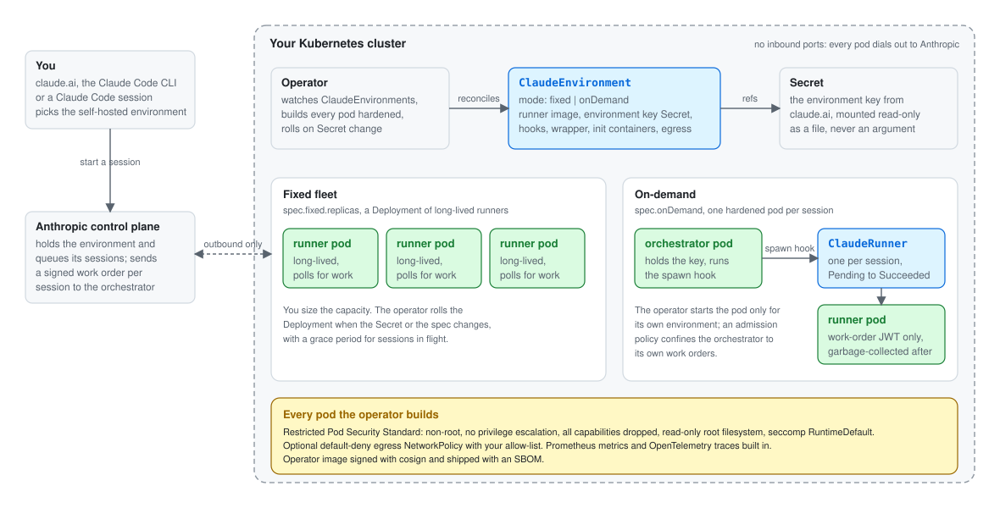

# Claude Code self-hosted environment operator

[](https://github.com/AhmadMasry/claude-self-hosted-environment-operator/actions/workflows/lint.yml)
[](https://github.com/AhmadMasry/claude-self-hosted-environment-operator/actions/workflows/test.yml)
[](https://github.com/AhmadMasry/claude-self-hosted-environment-operator/actions/workflows/test-e2e.yml)

A Kubernetes operator that runs [Claude Code self-hosted environments](https://code.claude.com/docs/en/self-hosted-environments)
on your cluster. You create one `ClaudeEnvironment` per environment from
claude.ai admin settings, point it at a runner image you build and a Secret
holding the environment key, and the operator runs the fleet: a fixed set
of runners, or an orchestrator that spawns one hardened pod per session.
Every pod meets the Restricted Pod Security Standard by default. Give each
on-demand environment its own namespace: its orchestrator can create
work-order Secrets there.

<picture>
  <source media="(prefers-color-scheme: dark)" srcset="docs/images/architecture-dark.svg">
  
</picture>

Status: pre-release. The API is `claude.cloudeng.ps/v1alpha1` and may still change; see
[API stability](#api-stability) for what that promises.
Every change runs through unit, envtest, kind e2e and upgrade e2e suites in CI, and a
manual [real-environment test](docs/testing.md#real-environment-test) registers with
Anthropic's control plane and routes a real session through the operator; see
[What a run looks like](#what-a-run-looks-like).

Install: the Helm chart (`oci://ghcr.io/ahmadmasry/charts/claude-selfhosted-operator`, values in its
[README](dist/chart/README.md)) or the kustomize installer attached to each
[release](https://github.com/AhmadMasry/claude-self-hosted-environment-operator/releases); the commands are in
the [quickstart](#quickstart).

Docs: [quickstart](#quickstart) below, [on-demand mode](docs/on-demand.md),
[customization](docs/customization.md) (entrypoint, init containers, wrapper script, lifecycle hooks),
[hardening](docs/hardening.md), [metrics](docs/metrics.md),
[upgrade](docs/upgrade.md), [troubleshooting](TROUBLESHOOTING.md),
[testing](docs/testing.md), [releasing](docs/release.md),
[security policy](SECURITY.md), [contributing](CONTRIBUTING.md).

## What a run looks like

A session on the operator, from the real-environment run of 2026-10-14 (ids are real): the environment
registers with Anthropic and reports `Ready`, a session started from the CLI lands on a runner pod the
orchestrator spawned for it, the runner succeeds when the session is released, and it is garbage-collected
two minutes later. A session started in claude.ai takes the same path.


<details>
<summary>The same transcript as text</summary>

```text
== create the environment (on-demand mode) and wait for it to register with Anthropic
$ kubectl apply -f environment.yaml
claudeenvironment.claude.cloudeng.ps/real created
$ kubectl get -n claude-real-e2e claudeenvironments
NAME  MODE      READY  REPLICAS  AGE
real  onDemand  True             15s
== start a session on it, from claude.ai or the CLI
$ claude -p "Reply with exactly the text: operator-real-e2e-1791997021" \
    --environment "$CLAUDE_ENVIRONMENT_ID" --ref test/readme-visuals --output-format json
{"ok":true,"session_id":"session_01WsFME7Xbwnr52yqsBt8VZy","title":"Operator real e2e 1791997021", ...}
== the orchestrator spawned a runner pod for the session
$ kubectl get -n claude-real-e2e clauderunners,pods -l claude.cloudeng.ps/environment=real
NAME                                                                  PHASE    SESSION                           POD                                   AGE
clauderunner.claude.cloudeng.ps/57f5899f-1a39-59bd-b130-33eaa3aa1778  Running  session_01WsFME7Xbwnr52yqsBt8VZy  57f5899f-1a39-59bd-b130-33eaa3aa1778  2s

NAME                                      READY  STATUS   RESTARTS  AGE
pod/57f5899f-1a39-59bd-b130-33eaa3aa1778  0/1    Running  0         2s
pod/real-orchestrator-65888d966c-p2jzp    1/1    Running  0         26s
pod/real-orchestrator-65888d966c-zmnb4    1/1    Running  0         26s
== the session replied and was released: the runner succeeded
$ kubectl get -n claude-real-e2e clauderunners,pods -l claude.cloudeng.ps/environment=real
NAME                                                                  PHASE      SESSION                           POD                                   AGE
clauderunner.claude.cloudeng.ps/57f5899f-1a39-59bd-b130-33eaa3aa1778  Succeeded  session_01WsFME7Xbwnr52yqsBt8VZy  57f5899f-1a39-59bd-b130-33eaa3aa1778  91s

NAME                                      READY  STATUS     RESTARTS  AGE
pod/57f5899f-1a39-59bd-b130-33eaa3aa1778  0/1    Completed  0         91s
pod/real-orchestrator-65888d966c-p2jzp    1/1    Running    0         115s
pod/real-orchestrator-65888d966c-zmnb4    1/1    Running    0         115s
== two minutes later (runnerTTLSecondsAfterFinished): garbage-collected, only the orchestrator remains
$ kubectl get -n claude-real-e2e clauderunners,pods -l claude.cloudeng.ps/environment=real
NAME                                    READY  STATUS   RESTARTS  AGE
pod/real-orchestrator-65888d966c-p2jzp  1/1    Running  0         3m56s
pod/real-orchestrator-65888d966c-zmnb4  1/1    Running  0         3m56s
```

</details>

Regenerate the recording with `hack/render-terminal-svg.py docs/images/user-flow.txt > docs/images/user-flow.svg`
and the architecture diagram with `hack/render-architecture-svg.py docs/images`. The transcript comes from the
tables `hack/real-session-test.sh` prints at each step, so every run of the
[real-environment test](docs/testing.md#real-environment-test) produces a fresh one.

## Quickstart

Anthropic publishes no runner image, so you build one. Runner pods run under the Restricted Pod Security Standard.

1. **Create the environment in claude.ai.** In admin settings, enable self-hosted environments and create
   one; Anthropic's guide is [Self-hosted environments](https://code.claude.com/docs/en/self-hosted-environments).
   You get two values. The *environment key* (`ccenvkey_...`) is shown once, at creation: it is what the
   operator needs, so copy it now. The *environment id* (`ccpool_...`) is in the environment's detail dialog:
   the operator does not use it; it is what `claude --environment <id>` takes to start a session from the
   CLI, while claude.ai picks the environment by name.
2. **Create the namespace** (Restricted Pod Security labels included):

       kubectl apply -f examples/namespace.yaml

3. **Store the key in a Secret** in the environment's namespace, under the key name `environment-secret`.
   It goes in through a file created with `umask 077`, never through a committed manifest or a shell
   argument:

       (umask 077 && cat > ./environment-secret)   # paste the key, Enter, Ctrl-D
       kubectl -n claude-runners create secret generic claude-env-secret --from-file=environment-secret=./environment-secret
       rm ./environment-secret

   The `ClaudeEnvironment` names that Secret in `spec.environmentSecretRef.name` (step 6). The operator
   mounts it read-only as a file and never logs its value; in on-demand mode only the orchestrator holds it.
   The key expires 365 days after creation. To rotate it, create a new key from the environment's
   Configuration tab in claude.ai, update the Secret, and revoke the old key once the pods have rolled:
   the operator rolls the fleet, or the orchestrator, on the change.
4. **Build and push the runner image.** See [`examples/runner-image`](examples/runner-image/README.md):

       docker build --build-arg CLAUDE_CODE_VERSION=<version> -t <registry>/claude-runner:<version> examples/runner-image
       docker push <registry>/claude-runner:<version>

5. **Install the operator.** With Helm, from a release:

       kubectl create namespace claude-selfhosted-operator-system
       kubectl label namespace claude-selfhosted-operator-system pod-security.kubernetes.io/enforce=restricted
       helm install claude-selfhosted-operator oci://ghcr.io/ahmadmasry/charts/claude-selfhosted-operator \
         --namespace claude-selfhosted-operator-system

   Without `--version` Helm installs the newest stable chart; pre-releases need `--version X.Y.Z-rc.N`
   or `--devel`. The values, their defaults and the cluster requirements (`admissionPolicy.enabled` needs
   Kubernetes 1.30) are in the chart's [README](dist/chart/README.md). To run without cluster-wide RBAC,
   with the operator and its environments in one namespace, see
   [namespaced install](docs/hardening.md#namespaced-install).

   Or with the installer of the newest stable release (it creates and labels the namespace itself; a
   pre-release's installer is under that release's assets):

       kubectl apply --server-side -f https://github.com/AhmadMasry/claude-self-hosted-environment-operator/releases/latest/download/install.yaml

   Or build the image yourself and deploy with kustomize from a checkout:

       make docker-build docker-push IMG=<your-registry>/claude-selfhosted-operator:<tag>
       make install
       make deploy IMG=<your-registry>/claude-selfhosted-operator:<tag>

   On-demand mode needs the manager to know its own image for the hook (`--hook-image`, default
   `OPERATOR_IMAGE`); the kustomize manifests set it automatically from `IMG`.

   On kind, replace `docker-push` with `kind load docker-image <your-registry>/claude-selfhosted-operator:<tag>`.

6. **Apply the example.** Edit `runner.image` in `examples/fixed-fleet.yaml` to your image first; its
   `environmentSecretRef` already names the Secret from step 3.

       kubectl apply -f examples/hooks-configmap.yaml -f examples/fixed-fleet.yaml

A minimal single-resource sample is in [`config/samples`](config/samples/claude_v1alpha1_claudeenvironment.yaml).

## Reading status

    kubectl get cenv -A
    kubectl -n claude-runners describe cenv platform

The list shows Mode, Ready, Replicas and Age. Conditions on `.status.conditions`:

| Condition | Meaning |
|---|---|
| `Ready` | The environment is serving as configured |
| `SecretFound` | The environment Secret and its key exist (`SecretMissing`, `SecretKeyMissing`) |
| `FleetAvailable` | Enough runners are available (on-demand: `OrchestratorUnavailable` when the orchestrator is not ready, `WorkloadApplyFailed` when applying the workload failed) |
| `Progressing` | A rollout or scale change is under way |
| `Degraded` | Something needs attention, for example `ConfigMapMissing`, `GracePeriodTooShort`, `RunnerFailedStart`, `HookImageUnset` |
| `SecretOnRunners` | The Secret is mounted on runner pods; `False/OnDemandSecretOnOrchestrator` in on-demand mode |

## Configuration notes

- **Egress.** `spec.runner.networkPolicy.enabled: true` adds a default-deny egress NetworkPolicy
  (`<env>-egress`): DNS to kube-dns, TCP 443 to the IPv4 ranges in `egressCIDRs` (at most 64), with
  `169.254.169.254` always excluded, plus the standard egress rules in `additionalEgress` (at most 16) for
  in-cluster services or other ports. On-demand environments also get `<env>-egress-apiserver` so the
  orchestrator reaches the API server. Off by default; see [hardening](docs/hardening.md#networkpolicy).
- **Validation.** `runner.image` needs a tag or digest and may not be `:latest`. `baseDir` and
  `podTemplate.volumeMounts` may not use `/etc/claude`, `/home/runner` or `/tmp`. `runner.env` may not set
  `SELF_HOSTED_RUNNER_HOST_CONFIG_DIR`, `SELF_HOSTED_RUNNER_CLIENT_LABEL` or
  `SELF_HOSTED_RUNNER_ENVIRONMENT_SECRET` (use `runner.hostConfig`, `settings.clientLabel` and
  `environmentSecretRef`). `env`, `volumeMounts` and `onDemand.orchestrator.env` take at most 64 entries;
  `onDemand.orchestrator.hookTimeoutSeconds` is at least 15. The messages are listed in
  [troubleshooting](TROUBLESHOOTING.md#admission-and-validation-errors).
- **Manager flags.** `--watch-namespaces` (comma-separated; empty watches all), `--log-level`
  (`debug`, `info`, `error`), `--log-format` (`json`, `text`), `--tracing-endpoint` (OTLP gRPC, default
  `$OTEL_EXPORTER_OTLP_ENDPOINT`), `--tracing-sample-ratio` (default 0.1), `--hook-image`,
  `--apiserver-endpoints` (comma-separated `ip:port`; empty reads the `default/kubernetes` Endpoints). The
  chart exposes each of them as a value.

## Hardening notes

`lockToAccount` accepts an email address. That value is stored in the ClaudeEnvironment object and passed to the
runner pod as an argument, so treat the object as containing personal data and limit who can read it. The operator
watches Secrets and ConfigMaps cluster-wide unless the manager runs with `--watch-namespaces`.
See [hardening](docs/hardening.md) for Anthropic's checklist mapped to the operator, and
[SECURITY.md](SECURITY.md) to report a vulnerability.

## Uninstall

Every `ClaudeRunner` carries a finalizer that the operator removes once the runner's pod is gone, so remove
the environments while the operator still runs, and the operator last:

1. Delete the `ClaudeEnvironment` objects and wait until no `ClaudeRunner` remains:

       kubectl delete claudeenvironments --all -A
       kubectl get clauderunners -A    # repeat until "No resources found"

2. Delete the environment namespaces, and the Secrets and ConfigMaps in them, if you no longer need them.
3. Uninstall the operator: `helm uninstall claude-selfhosted-operator -n claude-selfhosted-operator-system`,
   or `kubectl delete -f install.yaml` for the kustomize installer. The chart keeps the CRDs (`crd.keep`);
   delete them yourself to remove every remaining object of the API:

       kubectl delete crd claudeenvironments.claude.cloudeng.ps clauderunners.claude.cloudeng.ps

A namespace deleted in the wrong order, after the operator is gone or outside the namespaces it watches,
stays `Terminating` on the runner finalizers. Confirm the runner pods are gone, then clear the finalizers:

    kubectl get clauderunners -n <namespace> -o name \
      | xargs -r -I{} kubectl patch {} -n <namespace> --type=merge -p '{"metadata":{"finalizers":null}}'

## Development

    make test        # unit tests (envtest)
    make lint

See [CONTRIBUTING.md](CONTRIBUTING.md) and [testing](docs/testing.md).

## API stability

The CRDs follow the [Kubernetes API conventions](https://github.com/kubernetes/community/blob/master/contributors/devel/sig-architecture/api-conventions.md)
and [deprecation policy](https://kubernetes.io/docs/reference/using-api/deprecation-policy/).

- **Group.** `claude.cloudeng.ps` is fixed. Versions change; the group does not.
- **`v1alpha1`, the current version.** The schema may change incompatibly between
  releases. Every such change is listed under "API" in the [changelog](CHANGELOG.md)
  of the release that ships it, with the migration it needs. After 0.1.0 such changes
  are kept to a minimum; new fields are added as optional.
- **Beta.** Once the schema stops moving, `v1beta1` is served alongside `v1alpha1`
  with a conversion webhook and becomes the storage version. `v1alpha1` is then
  deprecated and stops being served no sooner than the policy's notice period for
  beta APIs (nine months or three minor releases, whichever is longer).
- **Status.** Only the operator writes `status`, through the status subresource.
  Conditions are `metav1.Condition` values; `Ready`, `Progressing` and `Degraded`
  are stable names, and their `reason` values are documented in
  [troubleshooting](TROUBLESHOOTING.md).

## Learn more

- Design: [`docs/superpowers/specs/2026-10-02-claude-selfhosted-operator-design.md`](docs/superpowers/specs/2026-10-02-claude-selfhosted-operator-design.md)
- Claude docs: [self-hosted environments](https://code.claude.com/docs/en/self-hosted-environments), [deploying them](https://code.claude.com/docs/en/self-hosted-environments-deploy)
