# Claude Code self-hosted environment operator

[](https://github.com/AhmadMasry/claude-self-hosted-environment-operator/actions/workflows/lint.yml)
[](https://github.com/AhmadMasry/claude-self-hosted-environment-operator/actions/workflows/test.yml)
[](https://github.com/AhmadMasry/claude-self-hosted-environment-operator/actions/workflows/test-e2e.yml)

A Kubernetes operator that runs [Claude Code self-hosted environments](https://code.claude.com/docs/en/self-hosted-environments)
on your cluster. You create one `ClaudeEnvironment` per environment from
claude.ai admin settings, point it at a runner image you build and a Secret
holding the environment key, and the operator runs the fleet: a fixed set
of runners, or an orchestrator that spawns one hardened pod per session.
Every pod meets the Restricted Pod Security Standard by default. Give each
on-demand environment its own namespace: its orchestrator can create
work-order Secrets there.

Status: pre-release. The API is `claude.cloudeng.ps/v1alpha1` and may still change; see
[API stability](#api-stability) for what that promises.
Every change runs through unit, envtest, kind e2e and upgrade e2e suites in CI, and a
manual [real-environment test](docs/testing.md#real-environment-test) registers with
Anthropic's control plane and routes a real session through the operator; see
[What a run looks like](#what-a-run-looks-like).

Install: the Helm chart (`oci://ghcr.io/ahmadmasry/charts/claude-selfhosted-operator`, values in its
[README](dist/chart/README.md)) or the kustomize installer attached to each
[release](https://github.com/AhmadMasry/claude-self-hosted-environment-operator/releases); the commands are in
the [quickstart](#quickstart).

Docs: [quickstart](#quickstart) below, [on-demand mode](docs/on-demand.md),
[hardening](docs/hardening.md), [metrics](docs/metrics.md),
[upgrade](docs/upgrade.md), [troubleshooting](TROUBLESHOOTING.md),
[testing](docs/testing.md), [releasing](docs/release.md),
[security policy](SECURITY.md), [contributing](CONTRIBUTING.md).

## What a run looks like

The real-environment test on 2026-10-12 (session ids are real, the pool id is masked by CI): the
operator deploys, an on-demand environment registers with Anthropic and reports `Ready`, its egress
policies exist, a session started with `claude -p --environment` runs on a runner pod the orchestrator
spawned, the Stop hook and the wrapper script report back, the post-session hook runs, and the runner
is garbage-collected.



<details>
<summary>The same transcript as text</summary>

```text
== operator ready
deployment "claude-selfhosted-operator-controller-manager" successfully rolled out
== namespace and sink
claudeenvironment.claude.cloudeng.ps/real created
== level 1: orchestrator connected
claudeenvironment.claude.cloudeng.ps/real condition met
  SecretFound=True  FleetAvailable=True (WorkloadAvailable)  Degraded=False  Ready=True
NAME                    POD-SELECTOR                                                               AGE
real-egress             claude.cloudeng.ps/environment=real                                        15s
real-egress-apiserver   claude.cloudeng.ps/environment=real,claude.cloudeng.ps/role=orchestrator   15s
== level 2: starting a session
create: {"ok":true,"session_id":"session_014tWpziKnUXt46SYStUXCoq","title":"Operator-real-e2e-1791838407", ...}
== level 2: runner lifecycle
runner phase: Running
== level 2: reply captured
{"session_id": "session_014tWpziKnUXt46SYStUXCoq", "reply": "operator-real-e2e-1791838407", "wrapper": "ran"}
== level 2: runner reaches Succeeded and is garbage collected
clauderunner.claude.cloudeng.ps/68c7665b-a8bc-59d7-834d-5cc5ce88bccf condition met
== level 2: post-session lifecycle hook ran
{"session_id": "session_014tWpziKnUXt46SYStUXCoq", "exit_reason": "interrupted", "env_url": "set"}
== real-environment test passed
```

</details>

Regenerate the image from the transcript with
`hack/render-terminal-svg.py docs/images/real-e2e-run.txt > docs/images/real-e2e-run.svg`.

## Quickstart

Anthropic publishes no runner image, so you build one. Runner pods run under the Restricted Pod Security Standard.

1. **Create an environment in claude.ai.** Enable self-hosted environments, create one, and copy its
   environment key (see the [Claude docs](https://code.claude.com/docs/en/self-hosted-environments)).
2. **Create the namespace** (Restricted Pod Security labels included):

       kubectl apply -f examples/namespace.yaml

3. **Create the Secret.** Follow the commented steps at the top of
   [`examples/fixed-fleet.yaml`](examples/fixed-fleet.yaml): the key goes in via a file with `umask 077`,
   never into a committed manifest. The Secret key name is `environment-secret`.
4. **Build and push the runner image.** See [`examples/runner-image`](examples/runner-image/README.md):

       docker build --build-arg CLAUDE_CODE_VERSION=<version> -t <registry>/claude-runner:<version> examples/runner-image
       docker push <registry>/claude-runner:<version>

5. **Install the operator.** With Helm, from a release:

       kubectl create namespace claude-selfhosted-operator-system
       kubectl label namespace claude-selfhosted-operator-system pod-security.kubernetes.io/enforce=restricted
       helm install claude-selfhosted-operator oci://ghcr.io/ahmadmasry/charts/claude-selfhosted-operator \
         --namespace claude-selfhosted-operator-system

   Without `--version` Helm installs the newest stable chart; pre-releases need `--version X.Y.Z-rc.N`
   or `--devel`. The values, their defaults and the cluster requirements (`admissionPolicy.enabled` needs
   Kubernetes 1.30; `networkPolicy.apiServerEndpoints` is required with `rbac.namespaced=true`) are in the
   chart's [README](dist/chart/README.md).

   Or with the installer of the newest stable release (it creates and labels the namespace itself; a
   pre-release's installer is under that release's assets):

       kubectl apply --server-side -f https://github.com/AhmadMasry/claude-self-hosted-environment-operator/releases/latest/download/install.yaml

   Or build the image yourself and deploy with kustomize from a checkout:

       make docker-build docker-push IMG=<your-registry>/claude-selfhosted-operator:<tag>
       make install
       make deploy IMG=<your-registry>/claude-selfhosted-operator:<tag>

   On-demand mode needs the manager to know its own image for the hook (`--hook-image`, default
   `OPERATOR_IMAGE`); the kustomize manifests set it automatically from `IMG`.

   On kind, replace `docker-push` with `kind load docker-image <your-registry>/claude-selfhosted-operator:<tag>`.

6. **Apply the example.** Edit `runner.image` in `examples/fixed-fleet.yaml` to your image first.

       kubectl apply -f examples/hooks-configmap.yaml -f examples/fixed-fleet.yaml

A minimal single-resource sample is in [`config/samples`](config/samples/claude_v1alpha1_claudeenvironment.yaml).

## Reading status

    kubectl get cenv -A
    kubectl -n claude-runners describe cenv platform

The list shows Mode, Ready, Replicas and Age. Conditions on `.status.conditions`:

| Condition | Meaning |
|---|---|
| `Ready` | The environment is serving as configured |
| `SecretFound` | The environment Secret and its key exist (`SecretMissing`, `SecretKeyMissing`) |
| `FleetAvailable` | Enough runners are available (on-demand: `OrchestratorUnavailable` when the orchestrator is not ready, `WorkloadApplyFailed` when applying the workload failed) |
| `Progressing` | A rollout or scale change is under way |
| `Degraded` | Something needs attention, for example `ConfigMapMissing`, `GracePeriodTooShort`, `RunnerFailedStart`, `HookImageUnset` |
| `SecretOnRunners` | The Secret is mounted on runner pods; `False/OnDemandSecretOnOrchestrator` in on-demand mode |

## Configuration notes

- **Egress.** `spec.runner.networkPolicy.enabled: true` adds a default-deny egress NetworkPolicy
  (`<env>-egress`): DNS to kube-dns, TCP 443 to the IPv4 ranges in `egressCIDRs` (at most 64), with
  `169.254.169.254` always excluded, plus the standard egress rules in `additionalEgress` (at most 16) for
  in-cluster services or other ports. On-demand environments also get `<env>-egress-apiserver` so the
  orchestrator reaches the API server. Off by default; see [hardening](docs/hardening.md#networkpolicy).
- **Validation.** `runner.image` needs a tag or digest and may not be `:latest`. `baseDir` and
  `podTemplate.volumeMounts` may not use `/etc/claude`, `/home/runner` or `/tmp`. `runner.env` may not set
  `SELF_HOSTED_RUNNER_HOST_CONFIG_DIR`, `SELF_HOSTED_RUNNER_CLIENT_LABEL` or
  `SELF_HOSTED_RUNNER_ENVIRONMENT_SECRET` (use `runner.hostConfig`, `settings.clientLabel` and
  `environmentSecretRef`). `env`, `volumeMounts` and `onDemand.orchestrator.env` take at most 64 entries;
  `onDemand.orchestrator.hookTimeoutSeconds` is at least 15. The messages are listed in
  [troubleshooting](TROUBLESHOOTING.md#admission-and-validation-errors).
- **Manager flags.** `--watch-namespaces` (comma-separated; empty watches all), `--log-level`
  (`debug`, `info`, `error`), `--log-format` (`json`, `text`), `--tracing-endpoint` (OTLP gRPC, default
  `$OTEL_EXPORTER_OTLP_ENDPOINT`), `--tracing-sample-ratio` (default 0.1), `--hook-image`,
  `--apiserver-endpoints` (comma-separated `ip:port`; empty reads the `default/kubernetes` Endpoints). The
  chart exposes each of them as a value.

## Hardening notes

`lockToAccount` accepts an email address. That value is stored in the ClaudeEnvironment object and passed to the
runner pod as an argument, so treat the object as containing personal data and limit who can read it. The operator
watches Secrets and ConfigMaps cluster-wide unless the manager runs with `--watch-namespaces`.
See [hardening](docs/hardening.md) for Anthropic's checklist mapped to the operator, and
[SECURITY.md](SECURITY.md) to report a vulnerability.

## Development

    make test        # unit tests (envtest)
    make lint

See [CONTRIBUTING.md](CONTRIBUTING.md) and [testing](docs/testing.md).

## API stability

The CRDs follow the [Kubernetes API conventions](https://github.com/kubernetes/community/blob/master/contributors/devel/sig-architecture/api-conventions.md)
and [deprecation policy](https://kubernetes.io/docs/reference/using-api/deprecation-policy/).

- **Group.** `claude.cloudeng.ps` is fixed. Versions change; the group does not.
- **`v1alpha1`, the current version.** The schema may change incompatibly between
  releases. Every such change is listed under "API" in the [changelog](CHANGELOG.md)
  of the release that ships it, with the migration it needs. After 0.1.0 such changes
  are kept to a minimum; new fields are added as optional.
- **Beta.** Once the schema stops moving, `v1beta1` is served alongside `v1alpha1`
  with a conversion webhook and becomes the storage version. `v1alpha1` is then
  deprecated and stops being served no sooner than the policy's notice period for
  beta APIs (nine months or three minor releases, whichever is longer).
- **Status.** Only the operator writes `status`, through the status subresource.
  Conditions are `metav1.Condition` values; `Ready`, `Progressing` and `Degraded`
  are stable names, and their `reason` values are documented in
  [troubleshooting](TROUBLESHOOTING.md).

## Learn more

- Design: [`docs/superpowers/specs/2026-10-02-claude-selfhosted-operator-design.md`](docs/superpowers/specs/2026-10-02-claude-selfhosted-operator-design.md)
- Claude docs: [self-hosted environments](https://code.claude.com/docs/en/self-hosted-environments), [deploying them](https://code.claude.com/docs/en/self-hosted-environments-deploy)
